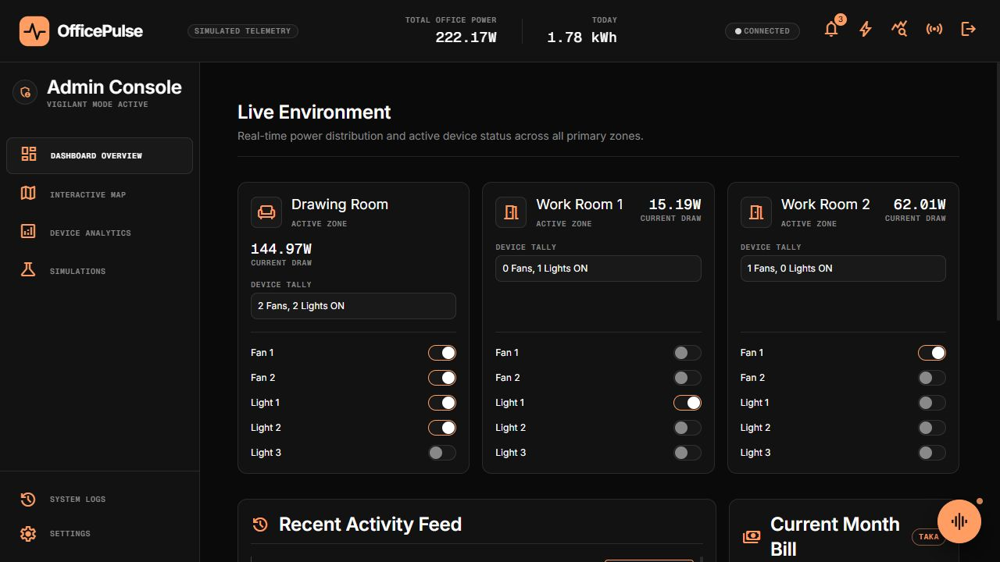
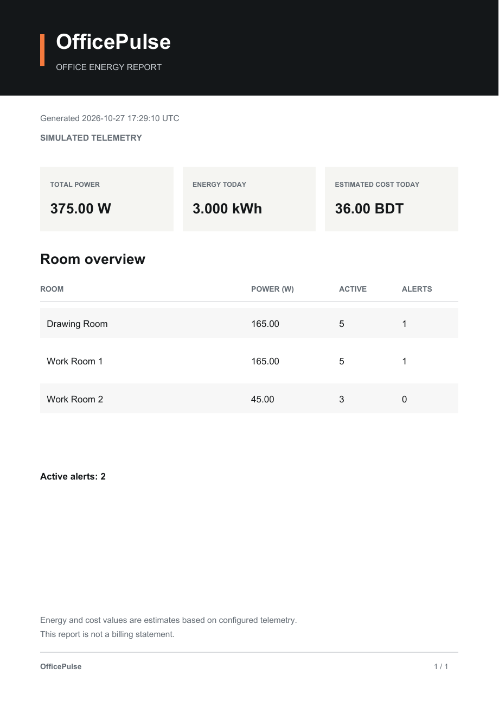

# OfficePulse · Office energy, in focus

[Live application](https://officepulse.tahmidkhan.com.bd) · [Render endpoint](https://officepulse.onrender.com) · [Deployment guide](docs/render-deployment.md) · [Architecture decisions](docs/adr)



A protected operations dashboard for room activity, device controls, energy consumption, estimated bills, alerts and simulations. The screenshot was captured from the deployed application using simulated telemetry. The hosted application requires the owner's administrator PIN; production credentials are never published here. A Render free service can take time to wake after inactivity.

## Features

- Monitor fifteen devices across three rooms with live power and occupancy telemetry.
- Explore an interactive floor map, device analytics, activity logs and energy estimates.
- Operate device and office shutdown controls with recent PIN re-verification.
- Handle alerts and reports; optionally integrate Discord and an assistant provider.
- Download the current snapshot as CSV or a valid PDF directly from Settings. Stored report creation remains available separately.
- Confirm protected actions in a masked six-digit PIN dialog with keyboard and cancel support.
- Share one dashboard snapshot, pause polling in hidden tabs, prevent overlapping requests, and retry visibly after a connection failure. Controls disable while data is unavailable.

For a hosted demo, set `ENABLE_FAKE_TELEMETRY=true` to keep enabled devices producing simulated readings. The dashboard and PDF identify simulated telemetry explicitly. Leave this flag false for a physical office. Simulated readings do not represent a physical meter. Bills and carbon figures are estimates using the configured tariff and telemetry.

OfficePulse is a real-time office energy monitoring system for 15 devices across three rooms, built around a shared Bun backend, Neon Postgres, Redis, Discord integration, simulator telemetry, a React dashboard, and a 6-digit platform PIN gate.

The repository includes architecture decisions, API collections, WebSocket events, hardware notes and deployment instructions in `docs/`.

## Repository Layout

- `apps/dashboard` - React + Vite PWA dashboard.
- `apps/api` - Bun HTTP and WebSocket API server.
- `apps/worker` - Redis stream consumers, alerts, automations, rollups, and reports.
- `apps/simulator` - Deterministic device and PIR telemetry simulator.
- `apps/discord-bot` - Discord Gateway, interactions, commands, and notifications.
- `packages/auth` - Platform PIN hashing, Redis-backed sessions, recent control re-verification, and cookie guards.
- `packages/contracts` - Shared API schemas, event types, and enums.
- `packages/domain` - Pure business logic and calculations.
- `packages/db` - SQL, migrations, repositories, and Neon connection handling.
- `packages/redis` - Redis keys, streams, pub/sub, locks, and cache helpers.
- `packages/agent` - AI provider adapter, tool registry, and confirmation state.
- `packages/config` - Typed environment configuration.
- `packages/logger` - Structured logging and correlation IDs.
- `packages/ui` - Shared dashboard UI components.
- `packages/testing` - Fixtures, fake clocks, and test helpers.

## First-Time Setup

1. Install Bun.
2. Copy `.env.example` to `.env` and fill the required values, including `PLATFORM_PIN_HASH` and `SESSION_COOKIE_SECRET`.
3. Run `bun install --frozen-lockfile`.
4. Start Redis with `docker compose -f infra/docker-compose.yml up -d redis`.
5. Run `bun run db:migrate`.
6. Run `bun run db:seed`.
7. Run `bun run dev`.

Open `http://localhost:5173`. Vite proxies API/WebSocket requests to port 3000. Built deployments serve the dashboard and API from the same origin; `VITE_API_URL` optionally points a separate frontend at an API.

### Isolated local simulator

To try the UI without cloud data, leave `DATABASE_URL`, `DATABASE_DIRECT_URL` and `REDIS_URL` empty in your local environment. Use `NODE_ENV=development`, `APP_ENV=local`, an empty `PLATFORM_PIN_HASH`, and your own six-digit `PLATFORM_DEV_PIN`. Skip migrations and seeding. Set `FEATURE_AI_CHAT=false` if no provider is configured. The development PIN fallback is disabled in production.

### Configuration

| Setting | Purpose |
| --- | --- |
| `API_PORT`, `APP_TIMEZONE` | Listener and office timezone |
| `DATABASE_URL`, `DATABASE_DIRECT_URL` | Runtime and migration Postgres connections |
| `REDIS_URL`, `REDIS_PREFIX` | Streams, cache and persistence |
| `PLATFORM_PIN_HASH`, `SESSION_COOKIE_SECRET` | Production access and sessions |
| `CONTROL_REAUTH_TTL_SECONDS` | Recent PIN authorization for controls |
| `CORS_ORIGINS`, `PUBLIC_API_URL`, `PUBLIC_WS_URL` | Hosted origins and endpoints |
| `DEFAULT_TARIFF_PER_KWH`, `CURRENCY`, `CARBON_KG_PER_KWH` | Estimate inputs |
| `FEATURE_*`, `AI_*`, `DISCORD_*` | Optional integrations; see `.env.example` |

Keep real `.env` files out of Git. Production requires a hashed PIN. Do not share an operational office PIN in a public README. Review database seed scripts before running them against existing data.

## Verification

```sh
bun test tests/contract
bun run typecheck
bun run --cwd apps/dashboard build
bun run --cwd apps/api build
```

Contract tests cover PIN handling, sessions, telemetry, alert lifecycle, shutdown commands and domain calculations. `/health` checks the process; `/ready` describes configured dependencies. Check actual database/Redis connectivity separately before treating a deployment as durable.

## Deployment and rollback

The existing Render service builds `Dockerfile` on a free instance. `render.yaml` lists environment settings. Configure secrets in Render, deploy the intended Git branch, and verify health, PIN login, telemetry and a simulator control.

`deploy/proxy` provides an optional Vercel external rewrite for a custom domain when Render's free workspace domain allocation is full. Import this directory with the Other preset; it proxies the existing Render application without duplicating the database. Add the new public origin to Render's `CORS_ORIGINS`, attach the domain in Vercel, and use Vercel's exact DNS target in Cloudflare. HTTP polling continues through this proxy; direct WebSocket consumers should use the Render endpoint.

Roll back an application release using the previous successful Render deployment. Container rollback does not reverse database migrations; keep schema changes backward-compatible. Free web instances sleep after inactivity and use ephemeral local storage, so use Neon/Redis for persistent cloud data.


## PDF export

Settings downloads a genuine one-page PDF containing the current snapshot, room power, active-device counts, alerts and clearly labelled energy/cost estimates. It uses the same values as the dashboard. The report is not a billing statement.

<details><summary>Preview the report layout with sample telemetry</summary>



</details>

